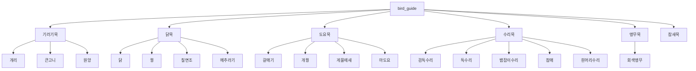

# bird_guide

## 오픈소스 소프트웨어 기초 과제

## 1. 구조

## 2. Contributor

| 담당 | GitHub |
|------|--------|
| 기러기목 | [@ppowwiuu](https://github.com/ppowwiuu) |
| 닭목 | [@hy87412](https://github.com/hy87412) |
| 도요목 | [@3414401](https://github.com/3414401) |
| 수리목 | [@nahcub](https://github.com/nahcub) |
| 앵무목 | [@gguak](https://github.com/gguak) |
| 참새목 | [@mskwak04](https://github.com/mskwak04) |