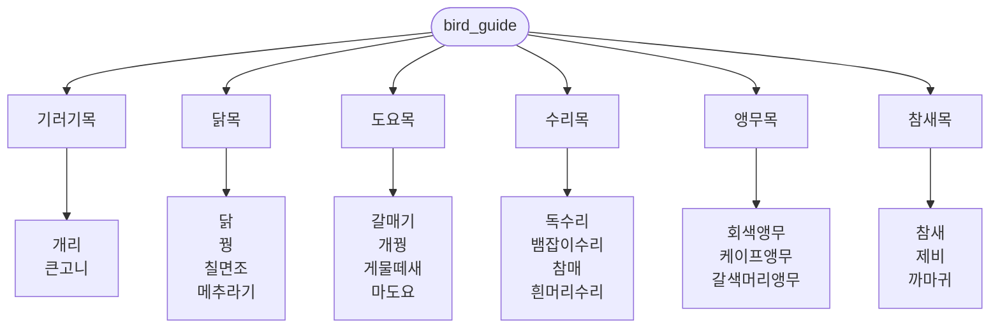

# bird_guide

## 오픈소스 소프트웨어 기초 과제

## 1. 개요

조류를 **목(目)** 단위로 분류해 정리한 한국어 조류 도감입니다.
팀원 6명이 목을 하나씩 맡아 GitHub에서 브랜치와 Pull Request로 협업하며 작성했습니다.

- 각 목 폴더에는 그 목을 소개하는 **목 문서**(`○○목.md`)와 **종별 문서**가 있습니다.
- 내용은 위키백과, 국립생물자원관 등 공개 자료를 바탕으로 정리했습니다.

## 2. 구조



## 3. 목차

| 목 | 학명 | 수록 종 |
|----|------|---------|
| [기러기목](기러기목/기러기목.md) | Anseriformes | 개리, 큰고니 |
| [닭목](닭목/닭목.md) | Galliformes | 닭, 꿩, 칠면조, 메추라기 |
| [도요목](도요목/) | Charadriiformes | 갈매기, 개꿩, 게물떼새, 마도요 |
| [수리목](수리목/수리목.md) | Accipitriformes | 독수리, 뱀잡이수리, 참매, 흰머리수리 |
| [앵무목](앵무목/앵무목.md) | Psittaciformes | 회색앵무, 케이프앵무, 갈색머리앵무 |
| [참새목](참새목/참새목.md) | Passeriformes | 참새, 제비, 까마귀 |

## 4. 문서 작성 규칙

### 파일 구성

```
○○목/
├── ○○목.md      # 목 소개 + 수록 종 링크
├── 종이름.md      # 종별 문서 (확장자 .md 필수)
└── 종이름.png     # 이미지 (선택)
```

### 종 문서 템플릿

```markdown
# 종이름 (영어 이름)


*출처: ○○, 저작자, 라이선스*

## 기본 정보
| 항목 | 내용 |
|------|------|
| 학명 | *Genus species* |
| 분류 | ○○목 > ○○과 > ○○속 |
| 몸길이 | |
| 분포 | |
| 국내 관찰 시기 | |
| IUCN 등급 | |

## 개요
## 생김새
## 분포와 서식지
## 생태
## 보전 상태
## 참고 자료

---
[← ○○목으로](○○목.md)
```

### 이미지·출처 표기
- 사진은 Wikimedia Commons 등 **재사용이 허용된 이미지**만 사용합니다.
- 사진 바로 아래에 `출처, 저작자, 라이선스`를 적습니다.
- 참고한 자료는 문서 맨 아래 `참고 자료`에 링크로 남깁니다.

## 5. 기여 방법

1. 본인 브랜치를 만듭니다. (`GitHub아이디-workspace`)
2. 담당 목 폴더에서 문서를 작성하고 커밋합니다.
   - 커밋 메시지 예: `[수리목] 참매.md 작성`
3. `main`으로 **Pull Request**를 엽니다.
4. 팀원 리뷰 후 `main`에 merge합니다.

## 6. Contributor

| 담당 | GitHub |
|------|--------|
| 기러기목 | [@ppowwiuu](https://github.com/ppowwiuu) |
| 닭목 | [@hy87412](https://github.com/hy87412) |
| 도요목 | [@3414401](https://github.com/3414401) |
| 수리목 | [@nahcub](https://github.com/nahcub) |
| 앵무목 | [@gguak](https://github.com/gguak) |
| 참새목 | [@mskwak04](https://github.com/mskwak04) |

## 7. 출처 및 라이선스

- 본문은 [위키백과](https://ko.wikipedia.org/), [국립생물자원관](https://species.nibr.go.kr) 등의 자료를 참고해 작성했습니다.
- 위키백과 기반 내용과 Wikimedia Commons 이미지는 [CC BY-SA 4.0](https://creativecommons.org/licenses/by-sa/4.0/deed.ko)을 따르며, 이 도감도 같은 라이선스로 공개합니다.