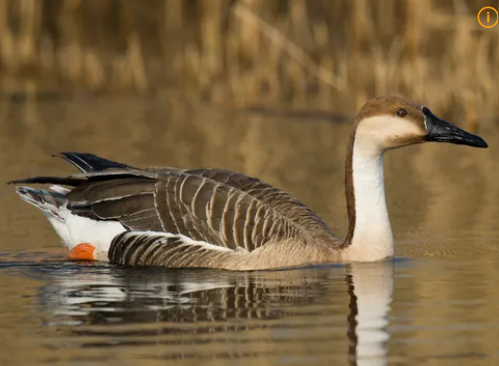

# 개리 (Anser cygnoides)

*개리 (Swan Goose). 출처: namu.wiki

## 기본정보
| 구분 | 내용 |
| :---: | :---: |
| **학명** | *Anser cygnoides* |
| **분류** | 기러기목 > 오리과 > 기러기속 |
| **영어이름** | Swan Goose |
| **몸길이** | 약 81 ~ 94 cm |
| **날개 편 길이** | 약 160 ~ 185 cm |
| **몸무게** | 약 2.8 ~ 3.5 kg |
| **분포** | 러시아 동부, 몽골, 중국 북동부 (번식) / 한국, 중국 남부, 일본 (겨울나기) |
| **국내 관찰 시기** | 겨울철새 (10월 ~ 3월) |
| **IUCN 등급** | 취약(VU, Vulnerable) |
| **국내지정** | 천연기념물 제325-1호, 멸종위기 야생생물 II급 |

## 개요
개리는 기러기목 오리과에 속하는 대형 기러기류로, 긴 목과 정수리부터 목 뒤쪽까지 이어지는 어두운 갈색 패턴이 특징입니다. 수천 년 전 가축화된 '거위'의 야생 조상 종입니다.

## 분류와 이름
학명 *Anser cygnoides*에서 *cygnoides*는 '고니(Swan)를 닮은'이라는 뜻입니다. 일반 기러기에 비해 목이 길어 고니처럼 보여 붙은 이름이며, 한국어 이름 '개리'는 '큰 기러기'를 뜻하는 옛말에서 유래했습니다.

## 생김새
- **머리와 목**: 정수리부터 목 뒤쪽은 어두운 밤색이며, 뺨과 목 앞쪽은 밝은 크림색/백색을 띠어 명확한 대비를 이룹니다.
- **부리**: 길고 검은색이며, 부리 시작 부분(기부)에 얇은 흰색 테두리가 있습니다.
- **몸깃 및 다리**: 몸 전체는 회갈색 바탕에 깃털 테두리가 밝아 비늘 무늬를 이루며, 다리는 주황색입니다.

## 분포와 서식지
- **서식지**: 번식기에는 강가, 습지, 고산 초지에서 지내며, 겨울철에는 강 하구, 농경지, 갯벌, 저수지 등에서 관찰됩니다.
- **국내 주요 서식지**: 한강 하구, 임진강, 금강 하구, 낙동강 하구 등지에서 무리를 이루어 월동합니다.

## 생태
겨울철에 수십~수백 마리 단위로 무리를 지어 생활합니다. 경계심이 매우 강하여 무리의 일부가 서서 경계를 서는 동안 다른 개체들이 먹이를 먹습니다.

## 먹이
**주로 식물성 먹이를 먹는 초식성입니다.**
- 풀의 뿌리, 줄기, 씨앗
- 벼이삭, 낙곡(떨어진 쌀알)
- 수생식물의 뿌리 (줄풀, 부들 등)

## 행동
- 날아오를 때 긴 목을 앞으로 쭉 뻗으며, 'V' 자 대형으로 비행합니다.
- 울음소리는 거위와 비슷하게 "껑-, 껑-" 하고 우렁차게 울립니다.

## 번식
- **시작 시기**: 5월경 몽골이나 시베리아 습지에서 번식을 시작합니다.
- **산란**: 땅 위에 풀이나 깃털을 깔아 둥지를 틀고 5~8개의 알을 낳습니다.
- **포란**: 암컷이 약 28~30일 동안 알을 품으며, 수컷은 주변을 경계합니다.

## 보전상태
농경지 개발, 습지 파괴, 농약 사용 등으로 인해 개체 수가 감소하고 있습니다. IUCN 적색목록에 **취약(VU)** 등급으로 등재되어 있으며, 한국에서는 천연기념물 및 멸종위기 야생생물 II급으로 보호받고 있습니다.

## 사람과의 관계
개리는 수천 년 전 동아시아에서 가축화되어 현재의 **거위(Chinese Goose)**가 되었습니다.

## 참고자료
- [국립생물자원관 한반도의 생물다양성 - 개리](https://species.nibr.go.kr/species/speciesDetail.do?ktsn=120000001373)
- [국가유산청 국가문화유산포털 - 개리](https://www.heritage.go.kr/heri/cul/culSelectDetail.do?culGbkCd=11&pageNo=1_1_2_0&culPageNo=1&pageType=search&pageNo=1_1_2_0&searchPage=search&searchYn=Y&searchType=integrated&searchStr=%EA%B0%9C%EB%A6%AC)
- [IUCN Red List - Swan Goose (*Anser cygnoides*)](https://www.iucnredlist.org/species/22679869/110940381)

## 이전 또는 다음 항목으로 이동
- [기러기목 (*Anseriformes*)](기러기목.md)
- [큰고니 (*Cygnus cygnus*)](큰고니.md)
- [원앙 (*Aix galericulata*)](원앙.md)
