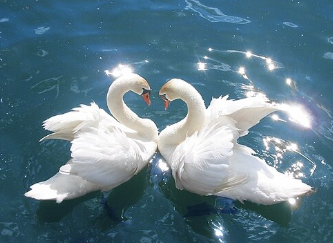

# 기러기목 (Anseriformes)

*기러기. 출처: ko.wikipedia

## 개요
기러기목은 조류강에 속하는 한 목으로, 전 세계의 수생 및 습지 환경에 널리 적응하여 살아가고 있는 물새 집단입니다. 흔히 오리, 기러기, 고니 등이 이 목에 포함되며, 대부분 물 위에서 헤엄치거나 자갈밭, 습지 등에서 먹이를 찾으며 살아갑니다.

## 공통특징
- **물갈퀴**: 발가락 사이에 막(물갈퀴)이 발달하여 수영에 최적화되어 있습니다.
- **부리 구조**: 부리가 대체로 납작하고 가장자리에 세밀한 빗살 모양의 판(라멜라)이 있어 물속의 먹이를 걸러 먹기 좋습니다.
- **깃털과 부유력**: 깃털에 방수성이 뛰어나며, 미구선(꼬리 근처의 기름샘)에서 나오는 기름을 온몸에 발라 물에 젖지 않습니다.
- **육아 및 번식**: 대부분의 종이 자리를 일찍 떠나는 '유조(Nidifugous)' 특성을 가져, 새끼가 알에서 깨어나자마자 스스로 걸어 다니며 먹이를 찾을 수 있습니다.

## 하위분류 (과 / 대표종)

| 과 (Family) | 한국어 명칭 | 주요 특징 | 대표종 |
| :--- | :--- | :--- | :--- |
| **Anatidae** | 오리과 | 기러기목 중 가장 큰 과로, 헤엄치는 수생 조류의 대표 | 기러기, 고니, 청둥오리, 원앙 |
| **Anhimidae** | 뻐꾸기오리과 | 남미에 서식하며 발에 물갈퀴가 일부만 발달함 | 뿔뻐꾸기오리 |
| **Anseranatidae** | 까치기러기과 | 호주에 서식하는 단형 과로, 발에 물갈퀴가 매우 짧음 | 까치기러기 |

## 이 도감에 실린 종
- [개리 (*Anser cygnoides*)](개리.md)
- [큰고니 (*Cygnus cygnus*)](큰고니.md)
- [원앙 (*Aix galericulata*)](원앙.md)

## 참고자료
- [국립생물자원관 한반도의 생물다양성](https://species.nibr.go.kr)
- 세계조류학회 (IOC World Bird List)
- IUCN Red List of Threatened Species
