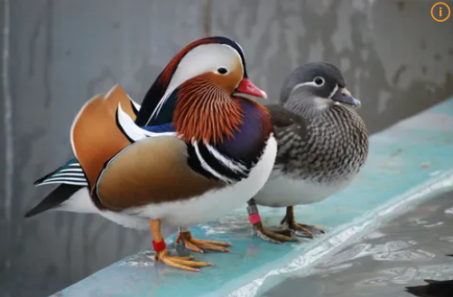

# 원앙(Mandarin Duck)
     

     
*원앙(Mandarin Duck), 출처: namu.wiki
     
## 기본정보
| 구분 | 내용 |
| :---: | :---: |
| **학명** | *Aix galericulata* |
| **분류** | 기러기목 > 오리과 > 원앙속 |
| **영어이름** | Mandarin Duck |
| **몸길이** | 약 41 ~ 49 cm |
| **날개 편 길이** | 약 65 ~ 75 cm |
| **몸무게** | 약 400 ~ 700 g |
| **분포** | 한국, 중국, 일본, 러시아 동부 (동아시아 특산) |
| **국내 관찰 시기** | 텃새 및 겨울철새 (연중 관찰 가능) |
| **IUCN 등급** | 관심대상(LC, Least Concern) |
| **국내지정** | 천연기념물 제327호 |
     
## 개요
원앙은 화려한 깃털 색깔로 잘 알려진 중소형 오리류입니다. 수컷의 극적인 화려함 덕분에 전 세계에서 가장 아름다운 오리 중 하나로 꼽히며, 예로부터 금슬 좋은 부부를 상징합니다.
     
## 분류와 이름
영어 이름 'Mandarin Duck'은 청나라 관복의 화려한 색상과 닮았다고 하여 붙여졌습니다. 한자어 '원앙(鴛鴦)'에서 '원(鴛)'은 수컷, '앙(鴦)'은 암컷을 의미합니다.
     
## 생김새
- **
수컷 (번식깃)**: 머리에 주황색/녹색/자색이 섞인 벼슬깃이 있고, 뺨에는 길고 주황색인 수염깃이 있습니다. 날개에는 부채 모양의 주황색 삼차깃('은행잎 깃')이 솟아 있습니다. 부리는 붉은색입니다.
- **
암컷**: 전체적으로 은회색 바탕에 눈 주위에 흰색 테두리(안경 모양)가 있으며 부리는 어두운 회색입니다.
- **
수컷 (비번식깃/변장깃)**: 번식이 끝난 여름철에는 암컷과 매우 유사한 회색 깃털로 바뀝니다.
     
## 분포와 서식지
- **
서식지**: 다른 오리들과 달리 산간 계곡, 산림 지역의 호수, 저수지 등 나무가 울창한 수변 환경을 좋아합니다.
- **
국내 주요 서식지**: 전국의 깨끗한 산간 계곡, 창경궁 춘당지, 한강 유역 등.
     
## 생태
나무 위에서 지내는 특이한 오리입니다. 발톱이 날카롭게 구부러져 있어 나뭇가지에 잘 앉으며, 나무 구멍(둥지)에 알을 낳습니다.
     
## 먹이
잡식성입니다.
- 
도토리, 밤, 식물 씨앗, 나무 열매
- 
소형 곤충, 달팽이, 개구리, 작은 물고기
     
## 행동
- 
물 위를 헤엄치다가도 위협을 느끼면 나무 위로 높이 날아올라 피신합니다.
- 
주로 경계할 때 "왝, 왝" 하는 소리를 냅니다.
     
## 번식
- **
시작 시기**: 4월 ~ 7월경 산림의 높은 나무 구멍에 둥지를 틀어 알을 낳습니다.
- **
산란**: 9~12개의 알을 낳습니다.
- **
이둥 행동**: 알에서 깨어난 새끼들은 부화 직후 어미의 부름을 받고 높은 나무 구멍에서 바닥이나 물 위로 뛰어내립니다.
     
## 보전상태
동아시아 특산종으로 서식지 파괴 및 고목 자르기 등으로 번식지가 줄어들고 있어, 한국에서는 천연기념물 제327호로 지정하여 보호하고 있습니다.
     
## 사람과의 관계
한국 전통례에서 부부간의 애정과 상합을 기원하는 전통 목원앙으로 쓰이며 금슬의 대명사로 여겨집니다.
     
## 참고자료
- [국립생물자원관 한반도의 생물다양성 - 원앙](https://species.nibr.go.kr/species/speciesDetail.do?ktsn=120000001382)
- [국가유산청 국가유산포털 - 원앙](https://www.heritage.go.kr/heri/cul/culSelectDetail.do?culGbkCd=11&pageNo=1_1_2_0&culPageNo=1&pageType=search&searchYn=Y&searchType=integrated&searchStr=%EC%9B%90%EC%95%99)
- [IUCN Red List - Mandarin Duck (*Aix galericulata*)](https://www.iucnredlist.org/species/22680107/111867123)
