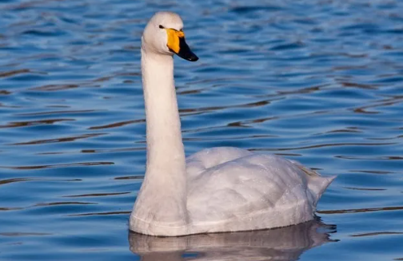

# 큰고니(Whooper Swan)

*큰고니(Whooper Swan), 출처: namu.wiki

## 기본정보
| 구분 | 내용 |
| :---: | :---: |
| **학명** | *Cygnus cygnus* |
| **분류** | 기러기목 > 오리과 > 고니속 |
| **영어이름** | Whooper Swan |
| **몸길이** | 약 140 ~ 165 cm |
| **날개 편 길이** | 약 205 ~ 235 cm |
| **몸무게** | 약 7.5 ~ 14 kg |
| **분포** | 유라시아 북부 툰드라 및 타이가 (번식) / 한국, 일본, 중국 동부, 유럽 (겨울나기) |
| **국내 관찰 시기** | 대표적인 겨울철새 (10월 ~ 3월) |
| **IUCN 등급** | 관심대상(LC, Least Concern) |
| **국내지정** | 천연기념물 제201-2호, 멸종위기 야생생물 II급 |

## 개요
큰고니는 순백의 깃털과 부리의 선명한 노란색 표범 무늬가 특징인 대형 물새입니다. 한국을 찾는 고니류 중 가장 대표적인 겨울철새입니다.

## 분류와 이름
영어 이름인 'Whooper Swan'은 이 새가 날아가거나 울 때 내는 우렁찬 울음소리("후프-, 후프-")에서 유래했습니다. 일반 고니에 비해 몸집이 커서 '큰고니'라 불립니다.

## 생김새
- **부리**: 부리 끝은 검은색이고, 기부(뿌리 쪽)부터 콧구멍 아래까지 넓게 **삼각형 모양의 선명한 노란색**을 띱니다. (혹고니처럼 부리에 혹이 없습니다.)
- **깃털**: 성조는 온몸이 순백색입니다. 어린 새(유조)는 전체적으로 회갈색을 띱니다.
- **다리**: 검은색입니다.

## 분포와 서식지
- **서식지**: 호수, 저수지, 강 하구, 갯벌, 잔잔한 해안 등 수심이 얕고 수생식물이 풍부한 곳에서 지냅니다.
- **국내 주요 서식지**: 낙동강 하구, 강릉 경포호, 진도 군내호, 한강 하구 등.

## 생태
가족 단위의 소규모 무리로 다니다가 겨울철 먹이터에서는 큰 무리를 형성합니다. 일생 동안 단일 우대(일부일처제)를 유지하는 결속력이 강한 새입니다.

## 먹이
수생식물의 잎, 줄기, 뿌리를 주식으로 합니다.
- 줄풀, 부들, 검정말 등의 수생식물
- 잔디, 풀의 뿌리, 농경지의 낙곡

## 행동
- 긴 목을 활용해 수심 1m 안팎의 물속에 목을 깊이 넣거나 몸을 뒤집어 뿌리를 채식합니다.
- 날아오를 때 수면을 발로 차며 달려나가 부드럽게 이륙합니다.

## 번식
- **시작 시기**: 5월경 북구의 툰드라/타이가 습지에 나뭇가지, 이끼, 풀로 커다란 둥지를 만든다.
- **산란**: 4~7개의 연한 크림색 알을 낳습니다.
- **포란**: 암컷이 약 31~35일간 알을 품습니다.

## 보전상태
세계적으로는 관심대상(LC) 등급이나, 한국에서는 서식지 환경 변화 및 매립으로 월동지가 위협받고 있어 천연기념물 제201-2호 및 멸종위기 야생생물 II급으로 지정 보호합니다.

## 사람과의 관계
아름다운 모습과 평화로운 이미지 덕분에 동서양을 막론하고 시와 그림, 민담의 소재로 자주 등장합니다.

## 참고자료
- [국립생물자원관 한반도의 생물다양성 - 큰고니](https://species.nibr.go.kr/species/speciesDetail.do?ktsn=120000001375)
- [문화재청 국가문화유산포털 - 고니류](https://www.heritage.go.kr/heri/cul/culSelectDetail.do?culGbkCd=11&pageNo=1_1_2_0&culPageNo=1&pageType=search&pageNo=1_1_2_0&searchPage=search&searchYn=Y&searchType=integrated&searchStr=%EA%B3%A1%EB%8B%88%EB%A5%90)
- [IUCN Red List - Whooper Swan (*Cygnus cygnus*)](https://www.iucnredlist.org/species/22679847/110940028)
